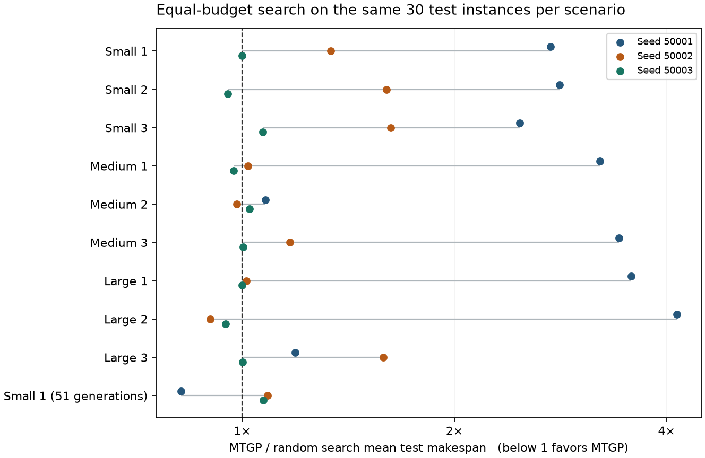

# MTGP 与等评估次数的随机双树搜索

检验的问题是，在同样多次雾计算模拟中，用遗传算子演化规则，相比反复随机生成规则，最终选出的调度规则在独立测试集上能节省多少时间。这里的成本单位为一次完整的工作流仿真。两种方法的表达式长度和求值耗时可以不同。

## 九场景短训练

**等评估预算下，随机搜索在全部九个场景取得更短的平均测试 makespan。** 27 个配对试次中，随机搜索赢 20 次、持平 2 次、MTGP 赢 5 次。上次短训练中 MTGP 超过了七种手工规则的 Medium 2 和 Large 3，这次的随机搜索在这两个场景也都超过了 MTGP。每场景仅有三个训练种子，结果描述本次预算下的表现。

| 场景 | MTGP 均值，秒 | 随机搜索均值，秒 | 随机胜 / 平 / MTGP 胜 |
| --- | ---: | ---: | ---: |
| Small 1 | 5365.07 | 3159.87 | 2 / 1 / 0 |
| Small 2 | 4375.80 | 2469.80 | 2 / 0 / 1 |
| Small 3 | 3949.02 | 2301.20 | 3 / 0 / 0 |
| Medium 1 | 8207.34 | 4695.52 | 2 / 0 / 1 |
| Medium 2 | 3748.97 | 3646.36 | 2 / 0 / 1 |
| Medium 3 | 7345.09 | 4120.28 | 3 / 0 / 0 |
| Large 1 | 14779.20 | 7735.47 | 2 / 1 / 0 |
| Large 2 | 12020.33 | 6000.20 | 1 / 0 / 2 |
| Large 3 | 6954.39 | 5501.67 | 3 / 0 / 0 |

Large 2 的三个种子说明均值容易受单次训练影响。尽管 MTGP 有两次胜出，种子 50001 的测试均值约为 25,009 秒，同一试次的随机搜索约为 6,047 秒。这个试次使 MTGP 的场景均值升至随机搜索的两倍。



## Small 1 的 51 代预算

| 演化 / 搜索种子 | MTGP，秒 | 随机搜索，秒 | MTGP 减随机，秒 |
| --- | ---: | ---: | ---: |
| 50001 | 2497.30 | 3050.00 | −552.71 |
| 50002 | 3037.71 | 2795.79 | +241.92 |
| 50003 | 3117.59 | 2910.09 | +207.50 |
| 三次均值 | **2884.20** | **2918.63** | **−34.43** |

在同一组 30 个测试实例上，MTGP 的均值比随机搜索低 1.18%。种子 50001 的收益超过另外两次的损失，决定了均值排序。按训练种子统计，随机搜索赢了 2 次，MTGP 赢了 1 次；三次训练均值的样本标准差分别为 127.32 秒和 337.44 秒。

## 配对设计

- 对照对象为此前保存的九场景短训练（每场景 3 次）以及 Small 1 的 51 代训练（3 次）。每个随机搜索试次对应一个 MTGP 试次，共 30 对。沿用 B04 初始化器、函数集、终端集与双树表示，两边的初始种群使用同一个种子。随机搜索始终从初始化分布重抽，目标深度 2–6 层；MTGP 后续交叉、变异生成的树可达 8 层。程序核对首批最优树及其 makespan 与原记录完全相同。
- 此后每一批都从初始化分布重新抽取规则；此前个体不参与繁殖。读取配对 MTGP 每代的训练实例种子，以及去除同代重复规则后实际评估的个数。随机搜索在同一实例上评估恰好这么多对不同的树。每批保留训练 makespan 最小的一对。
- 验证名额等于该 MTGP 试次实际验证过的不同规则数。如果随机搜索的不同批次冠军超出名额，就按各自获胜时的训练 makespan 从小到大保留；不足时再依训练成绩从其余规则中补足。相同训练分数保留先出现者。这一步跨不同训练实例比较原始分数，实例难度会影响入围。所有入围规则接受同样的三个验证实例评估，用验证均值选出唯一规则。
- 冻结规则后，在种子 90000–90029 的同一组 30 个实例上测试。每个训练试次先计算这 30 个 makespan 的均值，再在同场景 3 个训练试次之间比较。各方法共享测试实例；表中胜场按配对训练试次计数。

| 实验 | 试次对数 | 每种方法的训练调用 | 验证调用 | 测试调用 | 每种方法合计 |
| --- | ---: | ---: | ---: | ---: | ---: |
| 九场景，MTGP 8 个体 × 3 代 | 27 | 579 | 189 | 810 | 1578 |
| Small 1，MTGP 32 个体 × 51 代 | 3 | 4542 | 423 | 90 | 5055 |
| 合计 | 30 | 5121 | 612 | 900 | 6633 |

## 复跑

在 [运行手册](RUNNING.md) 配置好的 B04 环境中执行以下命令。随机搜索从仓库中的 MTGP 记录读取预算，输出目录使用新路径。

```powershell
$rs = Join-Path $workDir 'random-search'
& $py "$expDir/run_random_search.py" --dax $dax --out $rs --workers 8
& $py "$expDir/analyze_random_search.py" --random $rs
```

每个试次的 JSON 记录各批次训练种子、评估次数、最优规则与分数，并保存验证成绩及最终选择。CSV 保存冻结规则的全部测试结果。分析脚本逐试次核对训练预算、验证名额、选中的规则和配对测试实例，再生成汇总。安装 Matplotlib 后加 `--plot` 可重画文中的配对图。Small 1 短训练的第一个随机搜索试次另行独立重跑，其规则记录与测试 CSV 均逐字节一致；这次复核不计入表中任一方法的预算。

[场景比较](results/random-search/summary.csv) · [逐试次配对](results/random-search/trials.csv) · [短训练原始记录](results/random-search/pilot/) · [51 代原始记录](results/random-search/long/)
