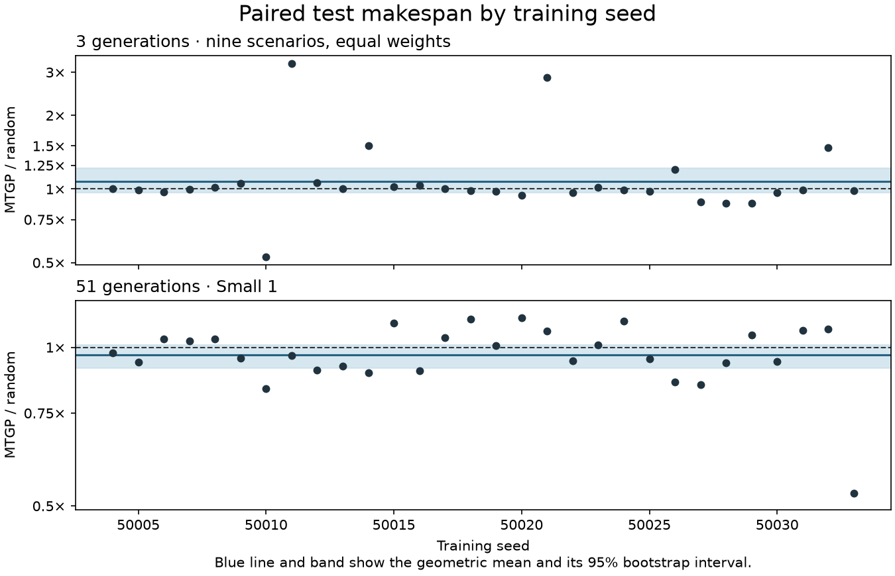

# 30 个新种子下的 MTGP 与等成本随机搜索

**短训练的九个场景中，随机搜索的平均完工时间全部更短。Small 1 延长到 51 代后，均值转为 MTGP 领先。两项主要比较的置信区间都跨过零，当前数据仍未显示 MTGP 能稳定胜过等仿真次数的随机搜索。**

训练种子 50004–50033 全部完成，与上一轮用于发现现象的三个种子分开分析。每个种子运行 10 组配对，两种方法在同一组 30 个实例上测试，共 300 对、每种方法 9,000 条测试成绩。每对均已从原始记录重新核对预算、首代最优规则、验证选择、测试实例和均值。[预定方案](PROTOCOL.md) · [完整核对数据](evidence.zip)

| 主要比较 | MTGP 相对随机的完工时间变化 | 95% 配对区间 | MTGP 胜 / 平 / 随机胜，按 30 个种子 |
| --- | ---: | ---: | ---: |
| 8 个体 × 3 代，九场景等权 | +7.36% | −3.40% 至 +21.84% | 16 / 0 / 14 |
| 32 个体 × 51 代，Small 1 | −3.35% | −8.57% 至 +1.02% | 16 / 0 / 14 |

正值表示 MTGP 完工时间更长。每个训练种子先对 30 个测试实例取算术平均，再求 MTGP 与随机搜索之比；短训练在一个种子内对九个比值取几何平均，最后再跨种子取几何平均。区间来自按种子重采样 50,000 次的百分位 bootstrap。两项双侧精确符号检验的原始 p 值均为 0.856，Holm 校正后均为 1。数据仍与两个方向的效果相容，未作等效性判定。

**为什么九场景的均值与种子胜负会给人不同印象？** 短训练的 270 个「场景 × 种子」配对中，随机搜索赢 116 次、平 59 次、MTGP 赢 95 次。把九场景先按同一个种子合并后，MTGP 赢了 16 个种子，但胜负次数没有反映差距大小。例如种子 50011、50021 的九场景配对比值分别达到 3.26 和 2.86；种子 50010 则为 0.53。51 代 Small 1 的算术均值为 MTGP **2812.59 秒**、随机搜索 **2922.37 秒**。



## 短训练各场景的算术均值

| 场景 | MTGP（秒） | 随机搜索（秒） |
| --- | ---: | ---: |
| Small 1 | 3600.62 | 3249.52 |
| Small 2 | 2892.81 | 2541.11 |
| Small 3 | 2812.42 | 2550.54 |
| Medium 1 | 5592.67 | 4769.20 |
| Medium 2 | 4246.26 | 3846.61 |
| Medium 3 | 4201.91 | 4000.94 |
| Large 1 | 9531.24 | 7574.33 |
| Large 2 | 6898.15 | 6150.22 |
| Large 3 | 7145.75 | 5496.56 |

每种方法实际运行 51,048 次训练仿真、6,003 次验证和 9,000 次测试，共 66,051 次。纯 CPU 分区 `kshctest02` 的 11 个作业均正常退出。Slurm 的计费用核数乘以分配时长合计 **63.28 核时**，低于 200 核时上限。耗时和模拟调用次数分别记录，匹配预算按后者定义。结论针对当前训练预算、仿真实现及固定测试集。[Slurm 用量](accounting.csv) · [逐种子比较](paired-trials.csv) · [全部区间和胜负](summary.csv)

## 复核

从仓库根目录执行下列命令可重新核对全部原始记录并生成统计表与图。统计需要 NumPy，绘图需要 Matplotlib。

```sh
python reproduction/analyze_seed_extension.py reproduction/seed-extension/evidence.zip --out verification --plot
```

单个配对使用 [run_seed_pair.py](../run_seed_pair.py)。在 [B04 运行环境](../RUNNING.md) 下指定 `--profile pilot --scale small --devices 1 --seed 50004 --dax <DAX目录> --out <新目录>` 即可重跑首个新种子。集群使用 Python 3.12.7、DEAP 1.4.4、NumPy 2.2.6。
